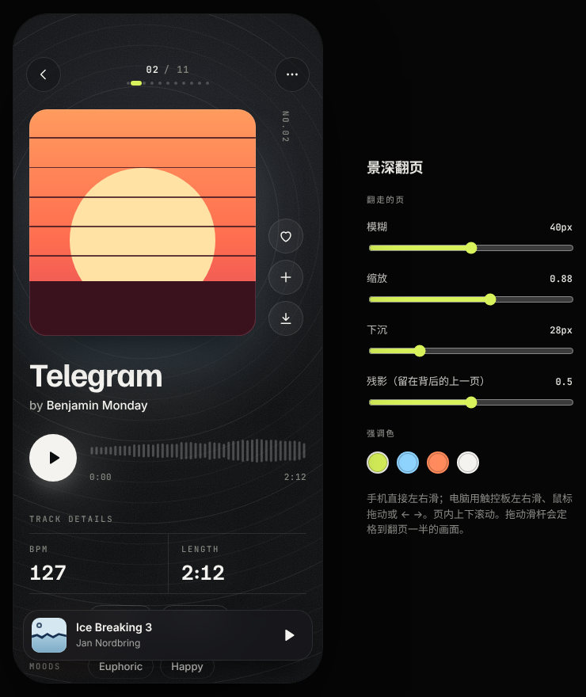
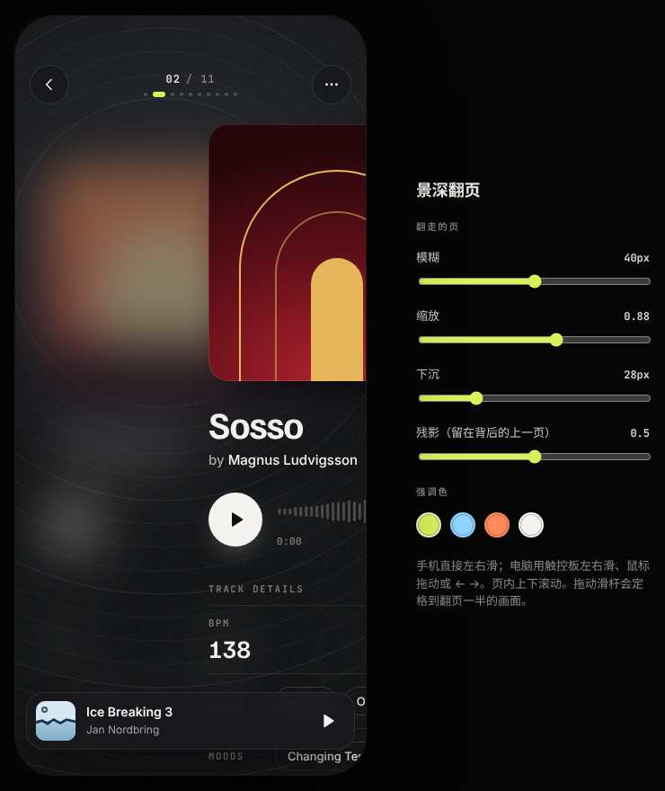
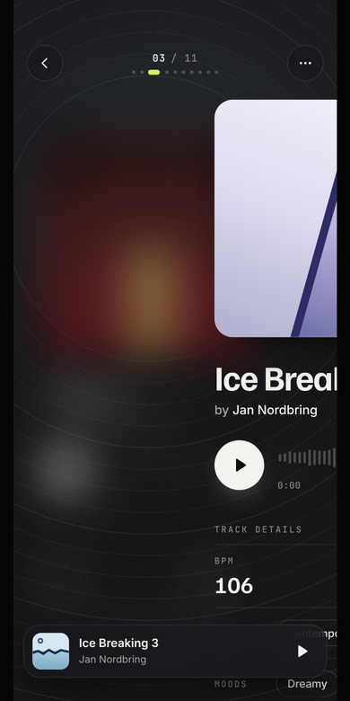

# 曲目页 UI demo · 景深翻页

一个手机尺寸（390×844）的音乐曲目页原型：背景固定不动，只有内容在动。

- 页内可以上下滚动。
- 左右翻页时，翻走的页不往左移，而是原地缩小、下沉、变模糊，留在后面当新页面的实时虚化背景；再往后翻一页，它才淡出。
- 新的一页从右边滑上来盖住它。往回翻正好相反：上一页从后面浮上来，逐渐变清楚。

| 静止：上一页留在后面当虚化背景 | 翻到一半 | 手机上按住滑到一半 |
|---|---|---|
|  |  |  |

## 打开

直接用浏览器打开 `index.html`。字体从 Google Fonts 加载，离线时会用系统字体。

- 手机：左右滑翻页，上下滑浏览当前页。
- 电脑：触控板左右滑、鼠标拖动或按 ← → 翻页；滚轮上下滚动当前页。
- 点 Similar tracks 里的曲目会跳过去。底部迷你播放器可以播放和暂停（模拟播放，没有声音），点曲名回到正在播放的那一页。
- 右侧滑杆可以调翻走那一页的模糊、缩放、下沉和残影浓度；拖动滑杆时会定格到翻页一半的画面。
- 顶部可以切换模糊的驱动方式，对比流畅度（旁边显示每秒帧数和最长一帧的耗时，"自动翻页"可以不用手滑）：
  - **滚动时间线**：CSS `animation-timeline` 按滚动位置驱动，默认方式。
  - **JS 每帧改 blur**：滚动时 JS 每帧直接写 `filter: blur(Npx)`，页面有 `will-change`，是独立图层。
  - **JS 改 blur · 无 will-change**：同上，但去掉 `will-change`，看不提升图层时会不会卡。

## 实现要点

- **翻页用的是原生滚动。** 横向容器设 `scroll-snap-type: x mandatory`，每页一个吸附点，并设 `scroll-snap-stop: always`。拖动、惯性、吸附，以及在吸附过程中接着快速再滑，都交给浏览器；JS 只读取滚动位置。思路同 scroll-gesture.js。
- **翻走的页原地不动。** 每一页都是 `position: sticky; left: 0`。滚过去时它粘在原位，下一页按正常排版从右边滑上来盖住它。
- **景深效果由滚动位置驱动。** 支持滚动时间线的浏览器用 `animation-timeline` 把滚动位置直接映射到每页的 `transform`、`filter`、`opacity`；不支持的浏览器在 scroll 事件里由 JS 写入同样的值。
- **模糊用的是 `filter: blur()`，不是 `backdrop-filter`。** 每页设了 `will-change: transform, filter, opacity`，是独立的合成层，改模糊半径时不用重绘内容。
- 鼠标不能拖动原生滚动容器，所以鼠标拖动由 JS 手动移动，松手后平滑滚到目标页；触摸、触控板、触控笔都走原生滚动。

## 文件

| 路径 | 说明 |
|---|---|
| `index.html` | 可以直接打开的成品，由下面的源文件生成 |
| `canvas/Main.dc.html` | 源文件：Claude Design 画布的画板格式，样式、结构和逻辑都在这里 |
| `canvas/canvas.json` | 画布索引 |
| `tools/build.js` | 从 `canvas/Main.dc.html` 生成 `index.html` |
| `tools/lint.py`、`tools/smoke.js` | 检查标签是否闭合、模板变量是否都能取到值 |
| `tools/shoot.js` | 在无头 Chrome 里跑一遍触摸、滚轮、鼠标、键盘、跳转等操作并截图 |
| `tools/modes.js` | 检查三种模糊驱动方式都能正确切换 |

## 修改后重新生成

```bash
node tools/build.js canvas/Main.dc.html index.html
python3 tools/lint.py canvas/Main.dc.html /tmp/script.js /tmp/holes.json
node tools/smoke.js /tmp/script.js /tmp/holes.json
# 需要 Playwright；CHROME 可以指向本机的 Chrome
node tools/shoot.js index.html /tmp/shots
```

## 数据说明

曲目名、艺人、时长、BPM、风格和情绪取自 Epidemic Sound 上 *Ice Breaking 3* 的页面及其相似曲目列表。该页面没有给出 Ice Breaking 3 自己的 BPM 和标签，所以第一页的 BPM 显示"—"。封面都是用 CSS 画的抽象图形，没有使用 Epidemic Sound 的品牌元素。
